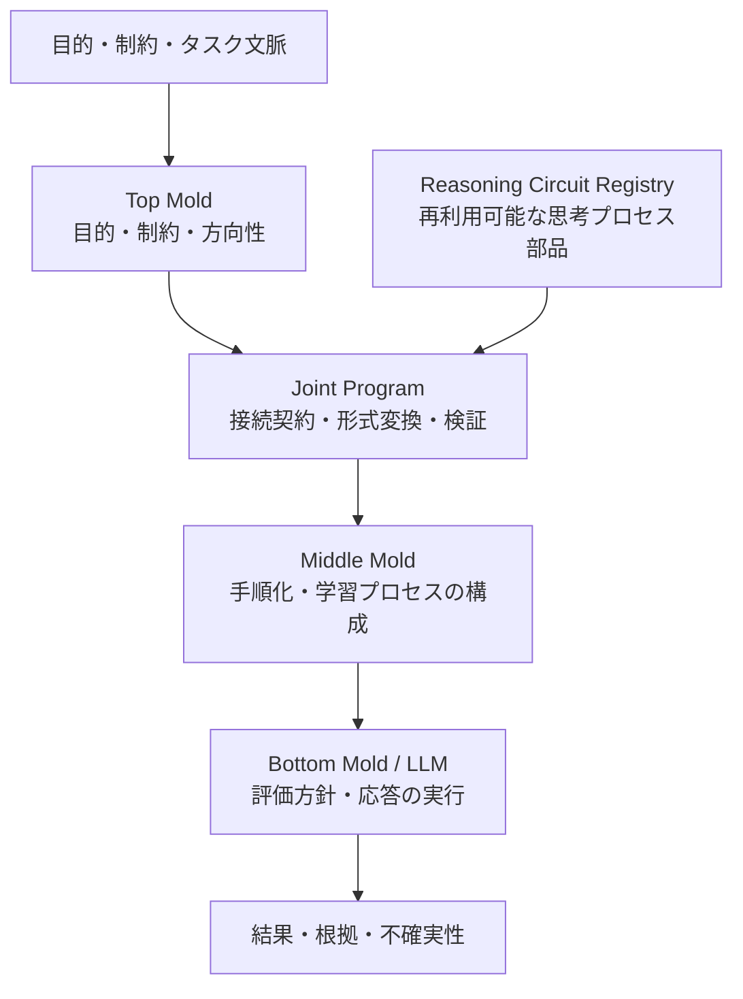

# Mold-Demo

**分解・再利用・接続できるプロセスモールドを試作するためのリポジトリです。**

Mold-Demo は、新しい AI モデルそのものを作るのではなく、LLM が持つ能力を目的に合わせて引き出すための「プロセスの型（Mold）」を、部品に分けて設計・再利用・組み合わせる構想です。

たとえるなら、ガンダムのストライカーパックのように、用途に応じた機能を換装するイメージです。ひとつの思考方式ですべてを解決するのではなく、目的に合う部品を選び、接続し、必要に応じて別の実装へ差し替えられる構造を目指します。

> **設計の中心:** モールドを使うだけでなく、モールドを分解し、組み合わせ、目的に合わせて作り直せるようにする。

## アーキテクチャ構想



これは現在の設計を説明する概念図です。すべての部品が一つの自動実行ランタイムとして統合済み、という意味ではありません。

## 各コンポーネント

### Top Mold — 目的・制約・方向性

利用者が達成したいこと、前提条件、個人に合わせた設定などを扱う層です。下位の処理が目的を見失わないよう、目的や制約を明示します。

### Reasoning Circuit — 交換可能な思考回路

特定の推論手法や思考プロセスを、再利用可能な部品として定義するためのカテゴリです。

- **Generic Reasoning Circuit:** 今回の汎用型。複数の用途で再利用できる基本部品を提供します。
- **Specialized Reasoning Circuit:** 特定の領域・目的に合わせて作る特化型です。
- **External Reasoning Circuit:** 将来、外部で公開された回路を参照・接続できるようにする拡張方向です。

新しい思考回路が必要になった場合、汎用型にすべての機能を詰め込むのではなく、別の回路として作り、共通の接続仕様を介して組み合わせることを目指します。回路は一つに固定せず、用途に応じて追加・差し替え可能な設計です。

現在の `resources.py` は、思考プロセスの定義・登録・検索・順序付き合成を扱う参照実装です。LLM の API 呼び出しや、LLM 内部の推論そのものを実行するモジュールではありません。

### Joint Program — 接続境界

異なる部品の間に、明示的な受け渡し契約を設けるための層です。

- 回路リソースを中立的な契約データへ変換する
- 入力・出力や識別子など、受け渡す情報を明示する
- 欠落・重複・無効なリソースや契約違反を検出する
- 下流のモールドが、リソース内部の実装に直接依存しないようにする

Joint Program は、LLM を呼び出したり、思考回路の順番を自動最適化したりする役割ではありません。まず接続境界を明確にし、部品の交換可能性と検証可能性を高めることを重視します。

### Middle Mold — プロセス構成

目的に対して、どのような手順・学習方法・確認工程を使うかを構成する層です。

現在の `middle_mold.py` は、学習科学の知見を参考にした**学習プロセスの参照実装**です。タスク情報から学習計画を組み立て、方法選択の理由、適応条件、評価項目、未解決事項などを明示します。任意のタスクを自動的に最適化する汎用オーケストレーターとして検証済み、という位置づけではありません。

### Bottom Mold / LLM — 評価方針と実行

LLM による応答・説明・生成などの実行層と、その結果を評価するための基準を分けて考えます。Bottom Mold の仕様では、パーソナライズ上の好みと、明示された正誤・受け入れ条件を混同しないことを重視しています。

現時点では仕様書を中心とした部分があり、LLM 実行環境を含む統合システムが完成しているわけではありません。

## リポジトリ構成

```text
mold-demo/
├── topｰmold/
│   ├── README.md
│   ├── TOP_MOLD_TEMPLATE.md
│   └── SESSION_ANALYSIS_TEMPLATE.md
├── middleｰmold/
│   ├── MIDDLE_MOLD.md
│   └── middle_mold.py
├── bottomｰmold/
│   ├── bottom_mold_spec.md
│   └── bottom_mold_llm_spec_v0.3_draft.md
├── joint/
│   └── joint_program.py
└── 思考回路/
    └── Reasoning Circuit/
        └── resources.py
```

ファイル構成は開発中に変わる可能性があります。各ディレクトリには、仕様書・テンプレート・参照実装が混在しています。

## まず読むファイル

| ファイル | 役割 |
|---|---|
| [Top Mold README](topｰmold/README.md) | Top Mold のスターターパックと利用上の注意 |
| [Top Mold Template](topｰmold/TOP_MOLD_TEMPLATE.md) | 目的・個人設定などを記述するテンプレート |
| [Session Analysis Template](topｰmold/SESSION_ANALYSIS_TEMPLATE.md) | セッションの結果、未確定事項、次の手順を整理するテンプレート |
| [Middle Mold Specification](middleｰmold/MIDDLE_MOLD.md) | 学習プロセス層の設計・選択規則・制約 |
| [Middle Mold Python](middleｰmold/middle_mold.py) | 学習計画を構成する Python 参照実装 |
| [Bottom Mold Specification](bottomｰmold/bottom_mold_spec.md) | 評価方針と許容条件の仕様 |
| [Bottom Mold Draft](bottomｰmold/bottom_mold_llm_spec_v0.3_draft.md) | LLM 向け仕様のドラフト |
| [Reasoning Circuit Resources](思考回路/Reasoning%20Circuit/resources.py) | 思考回路リソースの定義・登録・検索・合成 |
| [Joint Program](joint/joint_program.py) | 回路リソースと下流処理の間の接続契約 |

## 現在の状態

このリポジトリは **プロトタイプ／設計検証中** です。設計方針、仕様書、テンプレート、個別の参照実装を段階的に整備しています。

- 各モールドの仕様と責務の分離を進めています。
- Reasoning Circuit は再利用可能なリソースとして定義されています。
- Joint Program は接続契約と検証を担当する参照実装です。
- すべてのコンポーネントが一つの実行フローとして統合済みではありません。
- LLM の性能向上や、特定の学習・推論方法の有効性を実証済みと主張するものではありません。

**実装上の注意:** 現在の `joint_program.py` は `resources.py` を同じパッケージ内または同じ Python パス上から読み込む前提を含みますが、リポジトリ上では両ファイルが別ディレクトリに配置されています。接続テストを行う前に、パッケージ構成または import 経路をそろえる必要があります。

## 今後の方向性

1. **接続契約の安定化:** 回路の入出力、識別子、バージョン、エラー形式を明確にする。
2. **構成と実行の分離:** 回路定義、プロセス構成、LLM 実行、結果評価の責務を分ける。
3. **交換可能性の検証:** 異なる回路を同じ接続契約で扱えるか、契約テストで確認する。
4. **特化型回路の追加:** 汎用型を肥大化させず、用途ごとに独立した回路を作れる構造を整える。
5. **人とLLMの共進化:** 利用者がモールドを作り、LLMとの実践から設計や方法を改善できる循環を目指す。

## 設計上の原則

- **モールドはモデルそのものではなく、モデルの能力を目的に沿って引き出すためのプロセス設計です。**
- 人格・目的・処理方法・評価条件を、必要に応じて分離して扱います。
- 特定の思考方式を唯一の正解にせず、別の回路を追加・交換できることを目指します。
- 事実、推定、仮説、不確実性をできるだけ区別します。
- 仕様上の構想と、実装済み・検証済みの機能を混同しません。

---

このリポジトリは、完成した万能システムを提示するものではなく、**モールドを部品化し、接続し、作る方法そのものを再利用可能にしていくための実験場**です。
